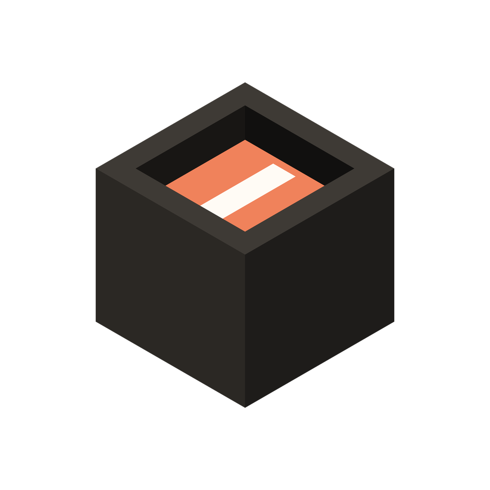

<!-- README-I18N:START -->
**Languages:** **English** · [简体中文](docs/i18n/README.zh_CN.md) · [繁體中文](docs/i18n/README.zh_TW.md) · [日本語](docs/i18n/README.ja.md) · [한국어](docs/i18n/README.ko.md) · [Français](docs/i18n/README.fr.md) · [Deutsch](docs/i18n/README.de.md) · [Español](docs/i18n/README.es.md) · [Português (Brasil)](docs/i18n/README.pt_BR.md) · [Русский](docs/i18n/README.ru.md) · [العربية](docs/i18n/README.ar.md) · [हिन्दी](docs/i18n/README.hi.md) · [ไทย](docs/i18n/README.th.md) · [Tiếng Việt](docs/i18n/README.vi.md) — see [TRANSLATIONS.md](TRANSLATIONS.md)
<!-- README-I18N:END -->

<div align="center">

<picture>
  <source media="(prefers-color-scheme: dark)" srcset="docs/brand/logo-dark-theme.png">
  <source media="(prefers-color-scheme: light)" srcset="docs/brand/logo-light-theme.png">
  
</picture>

# Boxing

**Your new tab is a spatial bookmark board.** Organize bookmarks into labeled boxes on an infinite, hierarchical canvas — drag, connect, and nest them spatially.

<p>
  <a href="#install">Install</a> ·
  <a href="#screenshots">Screenshots</a> ·
  <a href="#what-makes-it-different">Why</a> ·
  <a href="#usage">Usage</a> ·
  <a href="#privacy">Privacy</a> ·
  <a href="docs/store-publishing-plan.md">Store rollout</a>
</p>

<p>
  <a href="https://github.com/Xxx91n/boxing/releases/latest"></a>
  <a href="https://microsoftedge.microsoft.com/addons/detail/inkgieheaiifkkdmlpggihjplkkgpepi"></a>
  <a href="https://addons.mozilla.org/zh-CN/firefox/addon/boxing-newtab/"></a>
</p>

<p>
  <a href="https://github.com/Xxx91n/boxing/actions/workflows/test.yml"></a>
  <a href="https://github.com/Xxx91n/boxing/actions/workflows/build.yml"></a>
  <a href="LICENSE"></a>
  
  
</p>

</div>

Think Obsidian canvas meets bookmarks.

**Proof — the new tab page, out of the box:**

<p align="center">
  
</p>

## What Makes It Different

**Infinite canvas.** Pan and zoom freely (Ctrl+scroll, 30%–200%). Create as many boxes as you need, draw SVG connection lines between them, and mark parent boxes so children follow when the parent moves.

**Two-level hierarchy.** Large boxes hold small boxes; small boxes hold bookmarks. Click a box to enter its sub-canvas — breadcrumbs track the path, and nesting goes as deep as you like.

**Bookmark management.** Every box keeps its own bookmark collection in list or grid view: add, edit, delete, drag to reorder, and open links in the current tab or a new one (configurable).

**Connections.** Drag from a box edge to link two boxes. Alt+Click removes a line — or remap the delete gesture to single- or double-click in settings. Child boxes stay inside their parent's bounds with elastic clamping.

**Design.** Beige minimalist theme with light and dark modes (follows the system), adjustable font size and zoom, and a square/rounded corner toggle.

**14 languages.** en, zh_CN, zh_TW, ja, ko, fr, de, es, pt_BR, ru, ar, hi, th, vi — detected automatically from the browser locale.

## Screenshots

| Canvas | Boxes & Bookmarks | Connections |
|--------|-------------------|-------------|
|  |  |  |

| Settings | Bookmark Editing |
|----------|------------------|
|  |  |

## Brand Assets

Light/dark logos, extension icons, favicons, store tiles, and a variants showcase live in [`docs/brand/`](docs/brand/) — reuse them for store listings, docs, and the GitHub social preview.

## Install

> [!IMPORTANT]
> Install from the **official store pages** below — that is the supported end-user path. GitHub Releases carries the user-facing changelog and source/sideload zips; it no longer ships `.xpi` / `.crx` builds. Store signing and rollout: [publishing guide](docs/publishing-guide.md) · [store plan](docs/store-publishing-plan.md).

### Firefox (official install)

1. Open [Firefox Browser ADD-ONS — Boxing New Tab](https://addons.mozilla.org/zh-CN/firefox/addon/boxing-newtab/)
2. Click **Add to Firefox** and follow the browser prompts to finish installing

### Edge / Chromium (official install)

1. Open [Edge Add-ons — Boxing](https://microsoftedge.microsoft.com/addons/detail/inkgieheaiifkkdmlpggihjplkkgpepi)
2. Click **Get** to install — Chromium browsers, including Chrome, use the Edge store page for now; no Chrome Web Store listing exists yet (it is deferred until after the Edge rollout)

### Developers: build from source

```bash
git clone https://github.com/Xxx91n/boxing.git
cd boxing
npm ci
npm run build
```

- Chrome/Edge: `chrome://extensions` → Developer mode → **Load unpacked** → select `dist/boxing-chrome/`
- Firefox: `about:debugging#/runtime/this-firefox` → **Load Temporary Add-on** → select `dist/boxing-firefox/manifest.json`

> [!NOTE]
> Build output zips are for **store upload or local debugging only**, not the official end-user install path. Install from the store links above.
> Signing is handled by the stores; this repository's GitHub Releases **no longer** ship `.xpi` / `.crx`.

## Usage

- **Double-click** empty canvas → create a new box
- **Drag** box title bar → move box
- **Ctrl+scroll** → zoom canvas (30% to 200%)
- **Drag** empty canvas → pan
- **Right-click** → go back to parent canvas level
- **Click** a box → enter its sub-canvas
- **Drag** from box edge midpoint → connect to another box
- **Alt+Click** a connection line → delete it
- **Star icon** on a box → mark as parent (children move together)
- **Pin icon** → lock box position
- **Canvas top-right circle button** → unpin header for fullscreen mode

## Privacy

[privacy policy](docs/privacy-policy.md)

## Development

### Prerequisites

- Node.js 24.22.1 — pinned in `.nvmrc`; `engines.node` is `^24.22.1` and `.npmrc` sets `engine-strict=true`, so a runtime outside that range (below 24.22.1, or Node 25+) fails the install instead of silently running unsupported
- npm >= 11.10.0 (required so the 7-day release-age guard in .npmrc takes effect; ships with the pinned Node line)

### Setup

```bash
git clone https://github.com/Xxx91n/boxing.git
cd boxing
npm install
npx playwright install firefox chromium
npm run build
```

### Build

```bash
npm run build     # Dev build → dist/boxing-chrome + dist/boxing-firefox
npm run dev:chrome   # Build + launch Chrome with extension loaded (web-ext)
npm run dev:firefox  # Build + launch Firefox with extension loaded (web-ext)
npm run dev:chrome:no-build   # Fast reload without rebuilding (requires prior build)
npm run dev:firefox:no-build  # Fast reload without rebuilding (requires prior build)
npm test          # Playwright tests (Chrome + Firefox)
```

See [CONTRIBUTING.md](CONTRIBUTING.md) for the full development guide.

## Contributing

See [CONTRIBUTING.md](CONTRIBUTING.md) for setup, workflow, and code style.

New to the repository? [docs/START-HERE.md](docs/START-HERE.md) routes users, contributors, and agents to the right entry point.

## License

[Apache-2.0](LICENSE)
