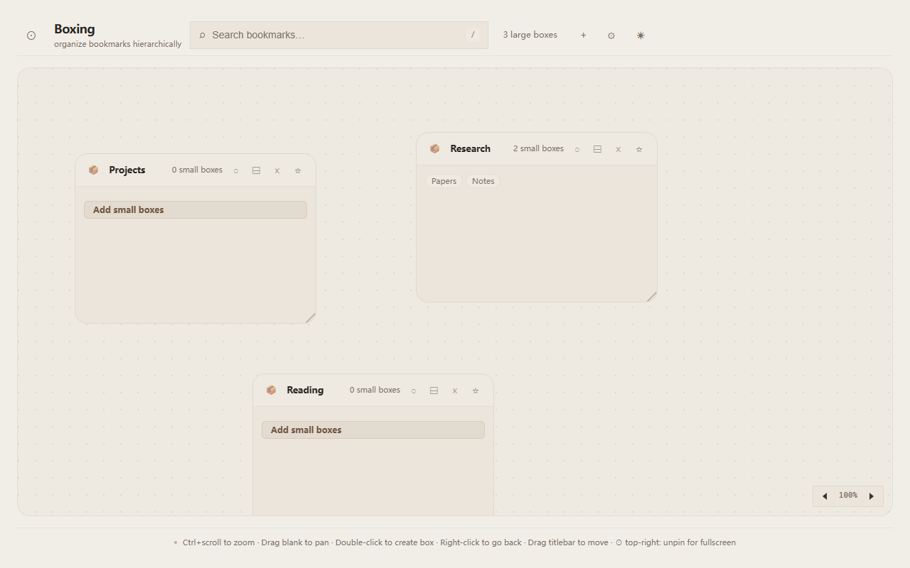
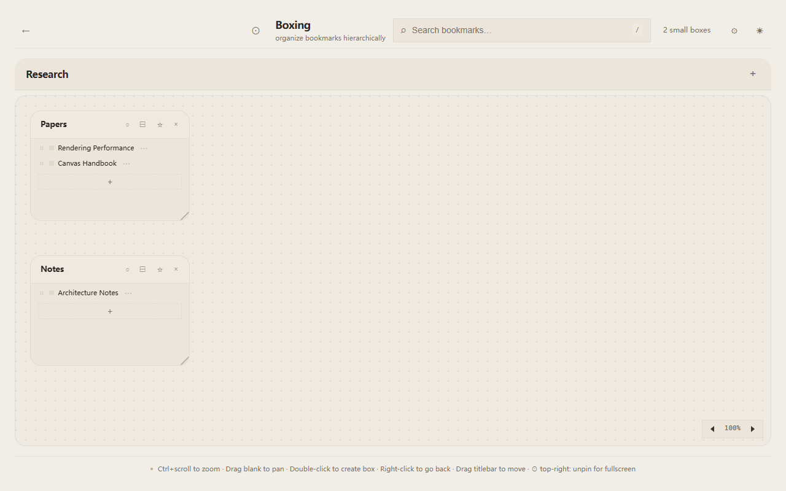
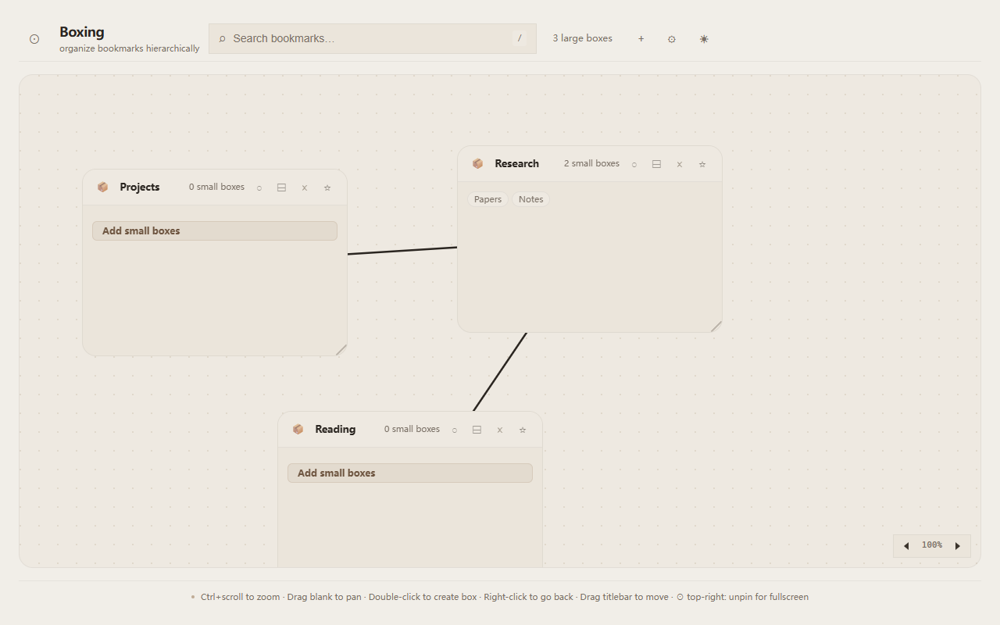
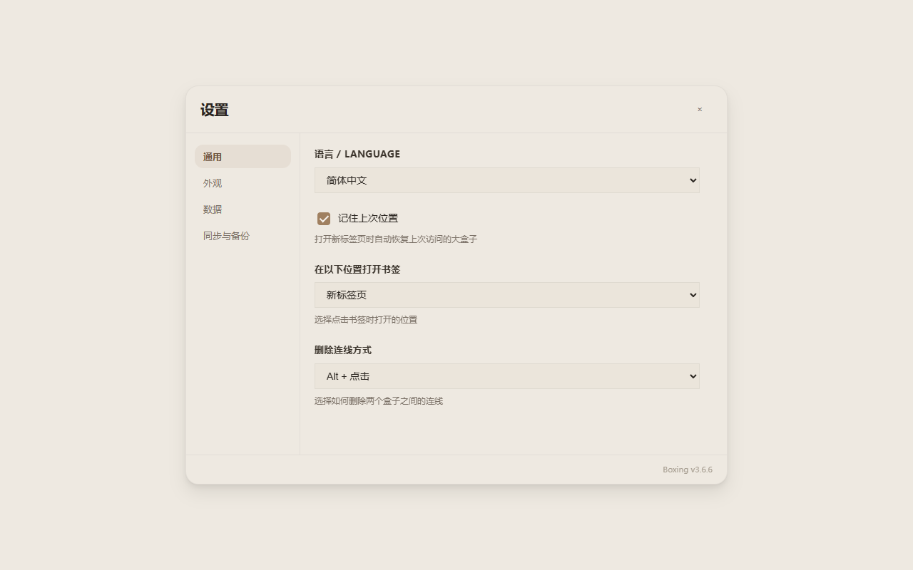
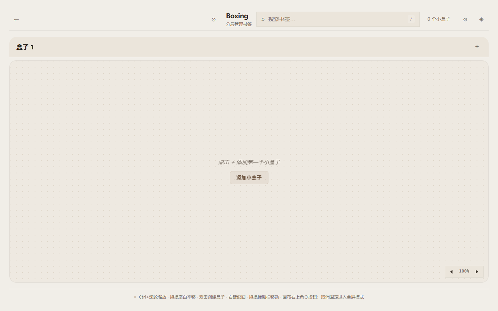

<!-- README-I18N:START -->
**Languages:** [English](../../README.md) · [简体中文](README.zh_CN.md) · [繁體中文](README.zh_TW.md) · [日本語](README.ja.md) · [한국어](README.ko.md) · [Français](README.fr.md) · **Deutsch** · [Español](README.es.md) · [Português (Brasil)](README.pt_BR.md) · [Русский](README.ru.md) · [العربية](README.ar.md) · [हिन्दी](README.hi.md) · [ไทย](README.th.md) · [Tiếng Việt](README.vi.md) — see [TRANSLATIONS.md](../../TRANSLATIONS.md)
<!-- README-I18N:END -->

# Boxing

Hierarchischer Lesezeichen-Manager auf unendlicher Leinwand im minimalistischen Beige-Design.

Boxing verwandelt Ihren neuen Tab im Browser in einen visuellen Arbeitsbereich für Lesezeichen. Keine starren Ordner mehr: Organisieren Sie Lesezeichen in beschrifteten Boxen auf einer unendlichen Leinwand — ziehen, verbinden und verschachteln Sie sie genau so, wie Sie denken. Stellen Sie es sich wie eine Obsidian-Leinwand für Lesezeichen vor.

<picture>
  <source media="(prefers-color-scheme: dark)" srcset="../../docs/store-assets/screenshots/screenshot-1-canvas.png">
  
</picture>

## Inhaltsverzeichnis

- [Funktionen](#funktionen)
- [Screenshots](#screenshots)
- [Installation](#installation)
- [Bedienung](#bedienung)
- [Datenschutz](#datenschutz)
- [Entwicklung](#entwicklung)
- [Mitwirken](#mitwirken)
- [Lizenz](#lizenz)

## Funktionen

**Unendliche Leinwand** : Freies Verschieben und Zoomen (Strg+Mausrad). Beliebig viele Boxen auf einer einzigen Leinwand erstellen. Beziehungen zwischen Boxen mit Verbindungslinien darstellen. Eltern-Kind-Beziehungen festlegen — Kind-Boxen bewegen sich mit, wenn die Eltern-Box verschoben wird.

**Zweistufige Hierarchie** : Große Boxen enthalten kleine Boxen, kleine Boxen enthalten Lesezeichen. Klick auf eine Box öffnet deren Unter-Leinwand. Breadcrumb-Navigation zeigt den Pfad an. Beliebig tief verschachtelbar.

**Lesezeichen-Verwaltung** : Jede Box besitzt ihre eigene Lesezeichen-Sammlung mit Listen- und Rasteransicht. Schnelles Hinzufügen, Bearbeiten und Löschen. Links können im aktuellen oder in einem neuen Tab geöffnet werden (konfigurierbar). Sortierung per Drag-and-Drop.

**Verbindungslinien** : Visuelle SVG-Linien zwischen Boxen. Alt+Klick auf eine Verbindung zum Löschen (konfigurierbar: Einfach- oder Doppelklick). Bewegungsausbreitung von Eltern zu Kindern mit elastischen Randbegrenzungen.

**Design und Themes** : Minimalistische Ästhetik in Beige / Creme. Dunkelmodus mit automatischer Systemanpassung. Anpassbare Schriftgröße und Skalierung. Umschaltung zwischen eckigen und abgerundeten Ecken.

**14 Sprachen** : en, zh_CN, zh_TW, ja, ko, fr, de, es, pt_BR, ru, ar, hi, th, vi (automatische Erkennung der Browsersprache).

<picture>
  <source media="(prefers-color-scheme: dark)" srcset="../../docs/store-assets/screenshots/screenshot-2-boxes.png">
  
</picture>

## Screenshots

| Leinwand | Boxen & Lesezeichen | Verbindungslinien |
|---|---|---|
|  |  |  |

| Einstellungen | Lesezeichen bearbeiten |
|---|---|
|  |  |

## Installation

> [!IMPORTANT]
> **Bitte über die offiziellen Store-Seiten installieren** (empfohlen). Die verbindlichen Installationsschritte und aktuellen Versionen werden in der [englischen README — Install](../../README.md#install) gepflegt.
> GitHub Releases dienen ausschließlich als **Änderungsprotokoll für Nutzer**: [Neueste Version](https://github.com/Xxx91n/boxing/releases/latest).

### Firefox (offizielle Installation)

1. [Firefox Browser ADD-ONS — Boxing New Tab](https://addons.mozilla.org/de/firefox/addon/boxing-newtab/) öffnen
2. Auf **Add to Firefox** klicken und den Browseranweisungen folgen, um die Installation abzuschließen

### Edge / Chromium (offizielle Installation)

1. [Edge Add-ons — Boxing](https://microsoftedge.microsoft.com/addons/detail/inkgieheaiifkkdmlpggihjplkkgpepi) öffnen
2. Auf **Abrufen** / **Get** klicken, um die Installation abzuschließen (Chromium-basierte Browser nutzen bitte die Edge-Store-Seite)

### Entwickler: Aus dem Quellcode bauen

```bash
git clone https://github.com/Xxx91n/boxing.git
cd boxing
npm ci
npm run build
```

- Chrome/Edge: `chrome://extensions` → Entwicklermodus aktivieren → **Entpackte Erweiterung laden** → `dist/boxing-chrome/` auswählen
- Firefox: `about:debugging#/runtime/this-firefox` → **Temporäres Add-on laden...** → `dist/boxing-firefox/manifest.json` auswählen

> [!NOTE]
> Die erstellten ZIP-Dateien dienen dem **Store-Upload oder lokalen Debugging**, nicht als regulärer Installationskanal für Nutzer. Reguläre Installationen bitte über die Store-Links oben durchführen.
> Die Signierung erfolgt durch den jeweiligen Store; dieses GitHub-Repository verteilt **keine** `.xpi` / `.crx` Dateien mehr über Releases.

## Bedienung

- **Doppelklick** auf freie Leinwand → Neue Box erstellen
- **Titelleiste ziehen** → Box verschieben
- **Strg+Mausrad** → Leinwand zoomen (30 % bis 200 %)
- **Freie Leinwand ziehen** → Ansicht verschieben (Pan)
- **Rechtsklick** → Zur übergeordneten Leinwand zurückkehren
- **Klick** auf Box → Unter-Leinwand öffnen
- Von der Kantenmitte einer Box **ziehen** → Mit anderer Box verbinden
- **Alt+Klick** auf Verbindungslinie → Linie löschen
- **Stern** auf einer Box → Als Eltern-Box festlegen (Kinder bewegen sich mit)
- **Pin-Symbol** → Position der Box sperren
- **Kreis-Schaltfläche** oben rechts → Fixierung lösen und in den Vollbildmodus wechseln

## Datenschutz

[docs/privacy-policy.md](../../docs/privacy-policy.md)

## Entwicklung

### Voraussetzungen

- Node.js 24.22.1
- npm

### Einrichtung

```bash
git clone https://github.com/Xxx91n/boxing.git
cd boxing
npm install
npx playwright install firefox chromium
npm run build
```

### Bauen

```bash
npm run build     # Entwicklungs-Build → dist/boxing-chrome + dist/boxing-firefox
npm test          # Playwright-Tests (Chrome + Firefox)
```

Weitere Details finden Sie im vollständigen Entwicklungsleitfaden in [CONTRIBUTING.md](../../CONTRIBUTING.md).

## Mitwirken

Beiträge sind herzlich willkommen! Details zu Umgebungseinrichtung, Arbeitsabläufen und Code-Stil finden Sie in [CONTRIBUTING.md](../../CONTRIBUTING.md).

## Lizenz

[Apache-2.0](../../LICENSE)
